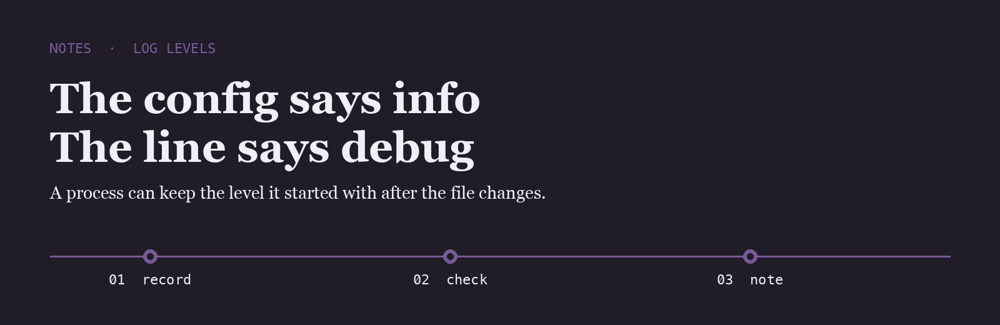
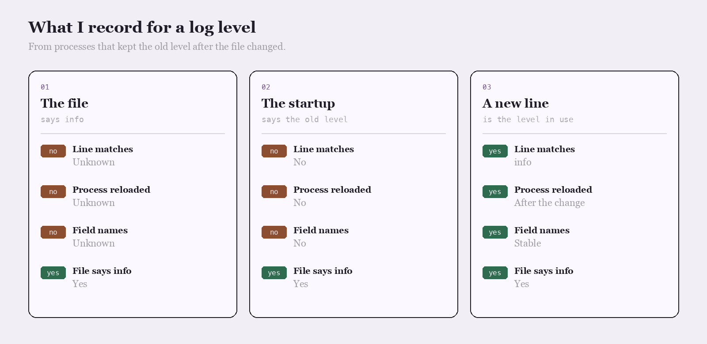

<p align="center">
  
</p>

# Helen Okoye

I compare one real log line with the level in the config. The file can say info while the process is still writing debug.

## The question

After you changed the level, did a new line show that level, or the one from startup?

<p align="center">
  
</p>

|  | The file | The startup | A new line |
| --- | --- | --- | --- |
| Line matches | Unknown | No | info |
| Process reloaded | Unknown | No | After the change |
| Field names | Unknown | No | Stable |
| File says info | Yes | Yes | Yes |

## The line I keep

The line I write when a new log line matches the file.

```text
2026-06-08  level info  field request_id  process reloaded  line matches the file
```

Editing the config is solved. Seeing that level on a new line is not.

- [zap](https://github.com/uber-go/zap) is the logger I read when the level is set at startup
- [zerolog](https://github.com/rs/zerolog) is the logger I compare when the fields change shape
- [logrus](https://github.com/sirupsen/logrus) is the logger I open when a line is still the old level

I keep a fork of each on this account.

## What I pay attention to

- A new line after the change
- Field names that stay stable
- Levels set where the process reads them
- One request id on the line

## Working with me

Send a short problem statement, a way to see it happen, and what done looks like. I am independent, remote, and usually around during the Brisbane morning.
